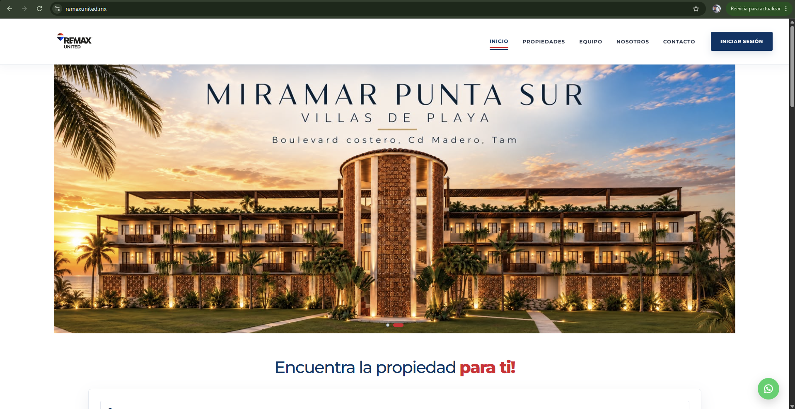
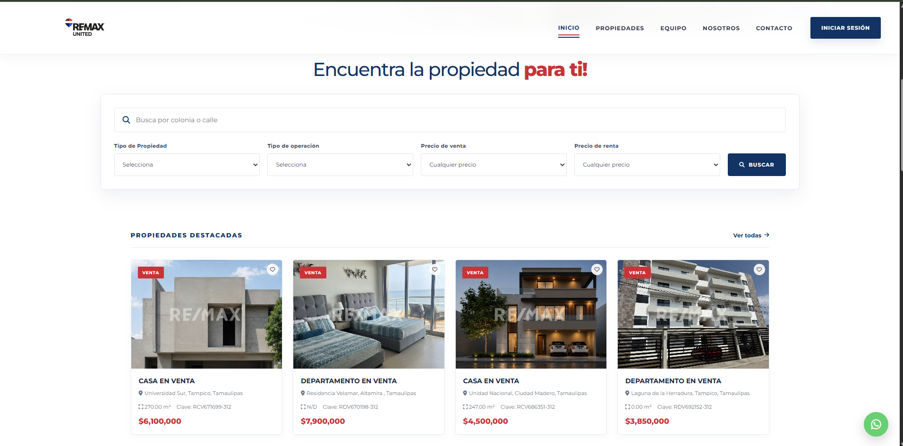
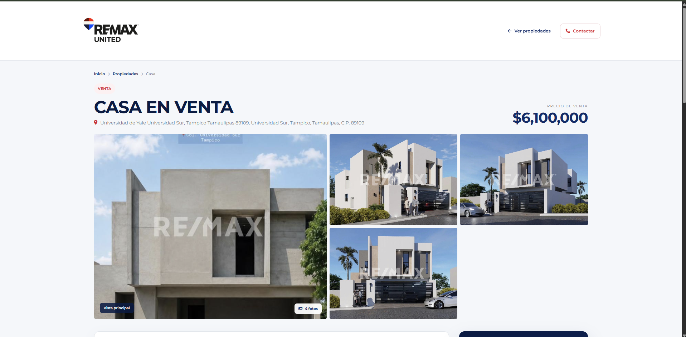
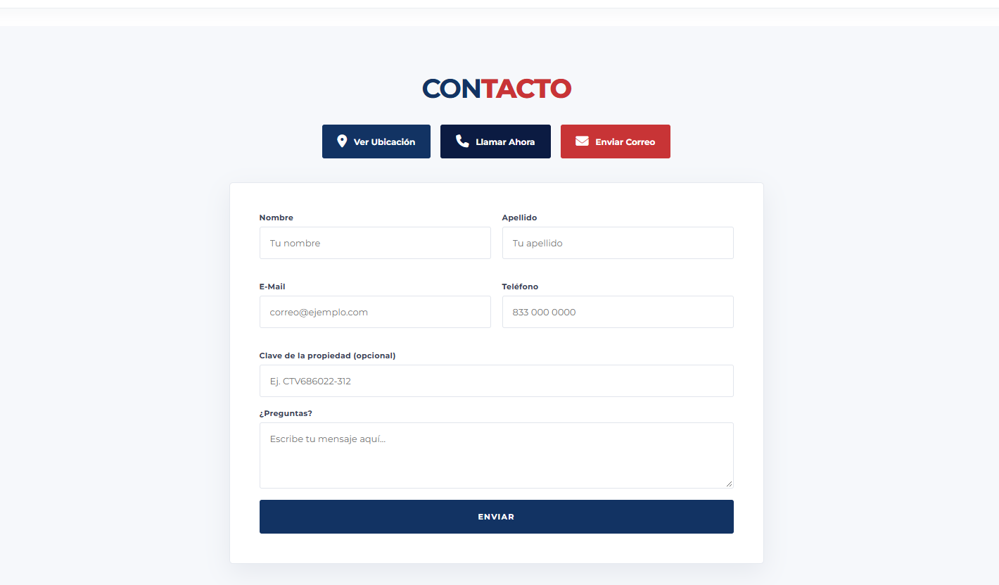

# REMAX UNITED | Plataforma Inmobiliaria

### Plataforma digital de gestión y comercialización inmobiliaria

Desarrollo de una plataforma web para **REMAX UNITED**, enfocada en facilitar la consulta, búsqueda y administración de propiedades inmobiliarias en venta y renta.

El proyecto integra una interfaz intuitiva, herramientas de búsqueda, administración de propiedades y conexión con una base de datos para gestionar la información de la plataforma.

---

##  Proyecto en producción

**Sitio web:** https://remaxunited.mx/

La plataforma se encuentra publicada y disponible para consulta.

---

##  Objetivo del proyecto

Desarrollar una solución digital que permita a una agencia inmobiliaria presentar su catálogo de propiedades de manera profesional, mejorar la experiencia de navegación de los usuarios y facilitar la administración de su inventario inmobiliario.

---

##  Funcionalidades principales

* Catálogo inmobiliario y visualización de propiedades.
* Búsqueda y filtros de inmuebles.
* Gestión de propiedades.
* Panel administrativo.
* Gestión de asesores inmobiliarios.
* Almacenamiento y consulta de información.
* Diseño adaptable a diferentes dispositivos.
* Integración entre frontend y backend mediante API.

---

##  Tecnologías utilizadas

**Frontend**

* HTML5
* CSS3
* JavaScript

**Backend**

* Node.js
* Express.js
* API REST

**Base de datos**

* MySQL

**Infraestructura**

* Linux VPS
* Nginx
* Servidor Node.js

---

##  Arquitectura general

La plataforma utiliza una arquitectura cliente-servidor:

1. **Frontend:** interfaz con la que interactúan los usuarios.
2. **Backend:** procesamiento de solicitudes y lógica de la aplicación.
3. **API REST:** comunicación entre frontend y backend.
4. **Base de datos:** almacenamiento de propiedades, asesores y demás información.
5. **Servidor:** alojamiento y publicación de la plataforma mediante infraestructura VPS.

---

## 📸 Galería del proyecto

### Página principal

### Catálogo y búsqueda de propiedades

### Detalle de una propiedad

### Acceso al panel administrativo

### Formulario de contacto

---

##  Desarrollo del proyecto

Participación en el análisis, diseño, desarrollo e implementación de la plataforma.

**Actividades realizadas:**

* Desarrollo de interfaces web.
* Implementación de funcionalidades frontend.
* Desarrollo de servicios backend.
* Integración con base de datos MySQL.
* Implementación de funcionalidades administrativas.
* Configuración del entorno de producción.
* Despliegue y puesta en funcionamiento en servidor VPS.

---

## 🔒 Privacidad y propiedad intelectual

Este repositorio tiene fines demostrativos y forma parte de un portafolio profesional.

Por motivos de privacidad y protección de la propiedad intelectual, el código fuente, las credenciales, la configuración interna y los datos privados de la plataforma no se encuentran publicados.

---

##  Información del proyecto

| Característica          | Información                            |
| ----------------------- | -------------------------------------- |
| Proyecto                | REMAX UNITED                           |
| Categoría               | Desarrollo web                         |
| Tipo                    | Plataforma inmobiliaria                |
| Estado                  | En producción                          |
| Tecnologías principales | HTML, CSS, JavaScript, Node.js y MySQL |
| Sitio web               | https://remaxunited.mx/                |

---

**REMAX UNITED — Plataforma inmobiliaria digital.**
